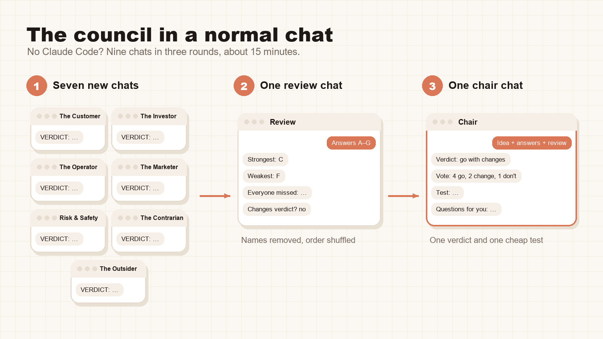
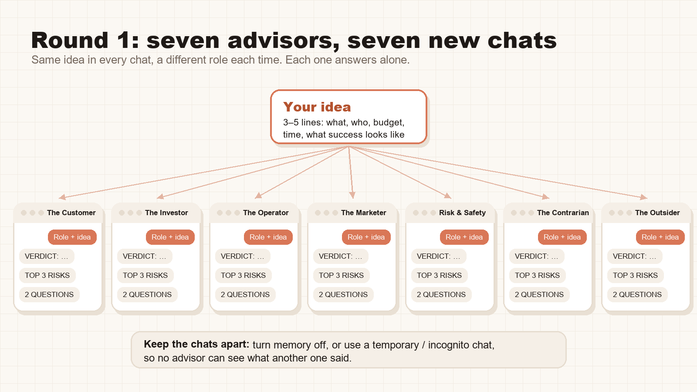
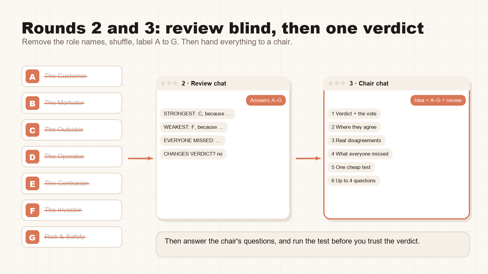

# The Idea Council: 7 AI advisors vet your idea before you build it

A free skill for **Claude Code**. You describe an idea or a decision. Seven AI advisors, each with a different job,
judge it on their own without seeing each other's answers. Then they review each other's answers anonymously, and a
chair gives you one verdict, one cheap test to run, and the questions only you can answer.

By Xav · [@itsxav.ai on Instagram](https://www.instagram.com/itsxav.ai/) · AI in plain English

| Advisor | Asks |
|---|---|
| The Customer | Would I actually use it or pay for it? |
| The Investor | Where does the money come from, and how soon? |
| The Operator | Who does the work every week, and what breaks first? |
| The Marketer | Can a stranger understand it in one sentence? |
| Risk & Safety | What could go wrong, and what's the simplest fix? |
| The Contrarian | What's the case against doing this at all? |
| The Outsider | What's confusing, and what's jargon? |

Why separate agents and not one long prompt: if one AI plays all seven roles in one reply, the later "advisors" can
see what the earlier ones said and drift towards agreeing. Separate helper agents answer blind first.

## Before you install any skill (including this one)
- **Read the whole file.** [`SKILL.md`](SKILL.md) is instructions your AI tool will follow. This one is plain text: it
  runs no commands, installs nothing and sends nothing anywhere.
- **Check who made it.** Be wary of skills that run commands, download files, ask for keys or send data out.
- **Expect it to use more of your plan.** A full council is about 15 agent runs; `quick` mode is 7. Save it for real
  decisions.

## Install (pick one)

**Easiest: let Claude Code do it.** Paste this into Claude Code:
```
Install the idea-council skill from https://github.com/Xyl0w/idea-council for me. Read SKILL.md first and tell me in two lines what it does, then save it as ~/.claude/skills/idea-council/SKILL.md.
```

**1. Download the file** (no terminal needed)
1. Open [`SKILL.md`](SKILL.md) and click the download button (↓, top right of the file).
2. Put it in a folder called `idea-council` inside your skills folder:
   - every project: `~/.claude/skills/idea-council/SKILL.md` (Windows: `C:\Users\<you>\.claude\skills\idea-council\SKILL.md`)
   - one project only: `<your project>/.claude/skills/idea-council/SKILL.md`

**2. One command** (Claude Code in a terminal)

Mac / Linux:
```bash
mkdir -p ~/.claude/skills/idea-council && curl -fsSL https://raw.githubusercontent.com/Xyl0w/idea-council/main/SKILL.md -o ~/.claude/skills/idea-council/SKILL.md
```
Windows (PowerShell):
```powershell
New-Item -ItemType Directory -Force "$HOME\.claude\skills\idea-council" | Out-Null; Invoke-WebRequest https://raw.githubusercontent.com/Xyl0w/idea-council/main/SKILL.md -OutFile "$HOME\.claude\skills\idea-council\SKILL.md"
```

**3. Clone it** (if you use git)
```bash
git clone https://github.com/Xyl0w/idea-council.git ~/.claude/skills/idea-council
```

Then restart Claude Code (or open a new session) so it picks the skill up.

## Use it
- Full council: `/idea-council I want to start a weekend meal-prep service for busy parents in my area`
- Quick (no peer review): `/idea-council quick ...`
- Give it your notes: "read plan.md first" and the advisors will read the file.

**What you get back:** a one-line verdict with the vote, where the advisors agree, the real disagreements, what all of
them missed, one test to run in the next two weeks, and up to 4 questions for you.

## Get a better verdict
- **Say who it's for and what success means.** "For parents in my area, 20 orders a week by March" beats "a food
  business".
- **Give it the real constraints:** your budget, the hours you have, what you're already doing.
- **Answer the chair's questions.** The verdict changes when it knows more.
- **Run the test before you trust the verdict.** It's seven opinions, not market research. No advisor knows your
  customers better than your customers do.

## No Claude Code? Run the council in a normal chat
Works in ChatGPT or the Claude app. About 15 minutes: nine chats in three rounds (seven advisors, one reviewer, one
chair). Slower than Claude Code, and you do the shuffling by hand, but it works anywhere.



### Before you start
- **Write your idea in 3–5 lines:** what it is, who it's for, your budget and time, and what success looks like.
  You'll paste the same lines into every chat.
- **Keep the chats apart.** If memory is on, a new chat can still draw on your other chats. Use a temporary chat
  (ChatGPT) or an incognito chat (Claude), or turn memory off while you do this, so no advisor sees another's answer.
- **Keep a note open** to collect the answers as you go.

### Round 1: seven advisors, seven new chats


Open a new chat for each advisor and paste this, with `[ROLE]` swapped for one of the role lines below:
```
You're one of seven advisors judging an idea. Argue your own point of view hard; don't try to sound balanced; don't make up statistics. If you'd need data you don't have, say what data.

Your role: [ROLE]

The idea: [YOUR 3-5 LINES]

Answer in exactly this shape:
VERDICT: go | change it | don't
WHY: up to 3 sentences
TOP 3 RISKS: each with how likely it is and what it would cost
THE ONE CHANGE I'D MAKE
2 QUESTIONS ONLY THE OWNER CAN ANSWER
```
The seven role lines, one per chat:
1. `The Customer: the person this is for. Would I actually use it, pay for it, or switch to it? What would I use instead today? What would make me trust it?`
2. `The Investor: where does the money come from, how much, and how soon? What does it cost to get one customer or one result? What's the cheapest way to prove it?`
3. `The Operator: who does the work, every week? How many hours? What breaks first when it gets busy? What has to stop to make room for it?`
4. `The Marketer: can you explain it in one sentence a stranger understands? How will people find it? What makes it different from what they already see?`
5. `Risk & Safety: what could go wrong for the owner or the users: private data, money, legal, reputation, security, depending on one platform or tool? For each risk, the simplest fix. Never a risk without a fix.`
6. `The Contrarian: the strongest case against doing this at all. What's the simpler alternative that gets most of the benefit?`
7. `The Outsider: no background in the field. What's confusing? What sounds like jargon? What would make you ignore it in 3 seconds?`

Copy each answer into your note as it comes in.

### Round 2: an anonymous review, one new chat


In your note, **delete the role names**, put the seven answers in a shuffled order and label them **A to G**. Then open
one new chat and paste:
```
Here are seven anonymous answers about the same idea, labelled A to G. Review them as a group.

The idea: [YOUR 3-5 LINES]

[ANSWERS A TO G]

Reply with:
STRONGEST ARGUMENT: letter + why
WEAKEST ARGUMENT: letter + why
WHAT EVERYONE MISSED
DOES THIS CHANGE THE OVERALL VERDICT? yes/no + one line
```
(The Claude Code version runs seven separate reviewers. By hand, one is enough.)

### Round 3: the chair, one last new chat
```
You're the chair of an advisory council. Below are my idea, seven advisors' answers (A to G) and a review of them. Write, in plain words and in this order:
1. Verdict in one line (go / go with changes / rethink) and the vote, e.g. 4 go, 2 change it, 1 don't.
2. Where they agree: bullets.
3. The real disagreements: each as two one-line sides.
4. What everyone missed.
5. One test to run in the next 2 weeks that would prove or kill the idea cheaply.
6. Up to 4 questions only I can answer. Ask them one at a time and update the verdict if an answer changes it.

The idea: [YOUR 3-5 LINES]

The answers: [ANSWERS A TO G]

The review: [THE ROUND 2 REPLY]
```
Answer the chair's questions, then **run the test before you trust the verdict**. It's seven opinions, not market
research.

## Credit
The method (separate answers, anonymous review, one chair's verdict) comes from Andrej Karpathy's
[LLM Council](https://github.com/karpathy/llm-council). The seven business advisors and the wording are mine.

---

Follow [@itsxav.ai](https://www.instagram.com/itsxav.ai/) for more ways to get real work out of Claude. Rather have it
set up or built for you? See CONSULT in my Instagram bio.
